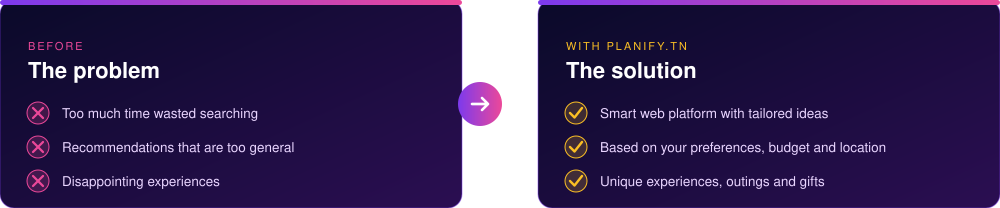
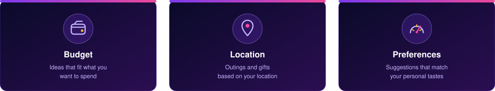
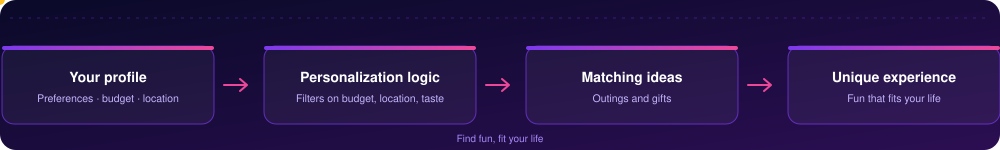

<div align="center">


<br>


**A smart web platform that recommends the right outings and gifts, based on your preferences, budget and location.**

*Find fun, fit your life.*

[Overview](#overview) · [Personalization](#personalization) · [My role](#my-role) · [Challenges](#challenges-and-lessons) · [Getting started](#getting-started) · [Author](#author)

</div>

---

## Overview

Planify.tn is a web application that acts as a personalized guide to fun and gifts. Instead of browsing endless generic lists, users get ideas that match who they are and what they are looking for.

<div align="center">



</div>

**Problem.** Finding an outing or a gift takes a lot of time, recommendations are too general, and the result is often a disappointing experience.

**Solution.** Planify.tn recommends ideas tailored to each user and aims to offer unique experiences.

> Project presented at the **9antra.tn Training Program** by Tasnim Elmehrabi, founder and developer.

## Personalization

Recommendations are driven by three filters.

<div align="center">



</div>

<div align="center">



</div>

| Filter | Purpose |
|---|---|
| Budget | Keep ideas within what the user wants to spend |
| Location | Suggest outings and gifts based on where the user is |
| Preferences | Match suggestions with the user's personal tastes |

## Screenshots

<!-- TO COMPLETE: add screenshots of the interface in docs/ and display them here, e.g.
<div align="center">


</div>
-->

A demo video of the interface was prepared to showcase the concept. <!-- TO COMPLETE: add the video link (YouTube, Drive) or a GIF in docs/ -->

## My role

| Area | Work done |
|---|---|
| Front-end development | Angular, HTML and CSS |
| UI/UX design | Clean, simple and user-friendly interface |
| Personalization logic | Filters on budget, location and preferences |
| Brand identity | Project name, vision, logo and design consistency |
| Demo preparation | Video of the interface to showcase the concept |

## Challenges and lessons

| Challenge | What it taught |
|---|---|
| Finding the right idea | Shaping the vision into something unique |
| Integration | Making the design and the features flow together |
| Angular 17 structure | Working without traditional NgModules |
| Routing | Understanding the simplified routing system and lazy loading |
| Debugging | Dealing with TypeScript strict mode, template errors and runtime bugs |

## Tech stack

| Area | Technologies |
|---|---|
| Framework | Angular 17 (Angular CLI 17.3.17) |
| Language | TypeScript (strict mode) |
| Markup and style | HTML5, CSS3 |
| Tests | Karma (unit tests) |

## Getting started

**Prerequisites**

- Node.js 18.13+ or 20+
- Angular CLI (`npm install -g @angular/cli`)

```bash
# Clone the repository
git clone https://github.com/tass027/planify-tn.git
cd planify-tn

# Install dependencies
npm install

# Start the development server
ng serve
```

Open [http://localhost:4200](http://localhost:4200). The app reloads automatically when you change a source file.

### Useful commands

| Command | Description |
|---|---|
| `ng serve` | Run the development server |
| `ng build` | Build the project, output in `dist/` |
| `ng test` | Run the unit tests with Karma |
| `ng generate component name` | Generate a new component |

## Author

**Tasnim Elmehrabi**, founder and developer · [GitHub](https://github.com/tass027) · [LinkedIn](https://www.linkedin.com/in/VOTRE-PROFIL)
